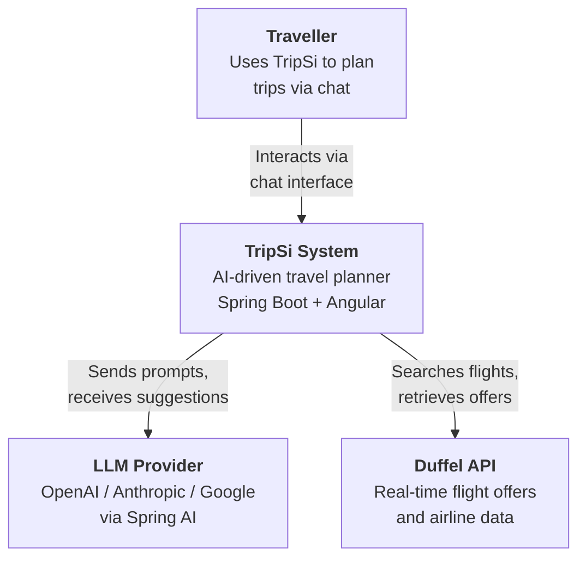
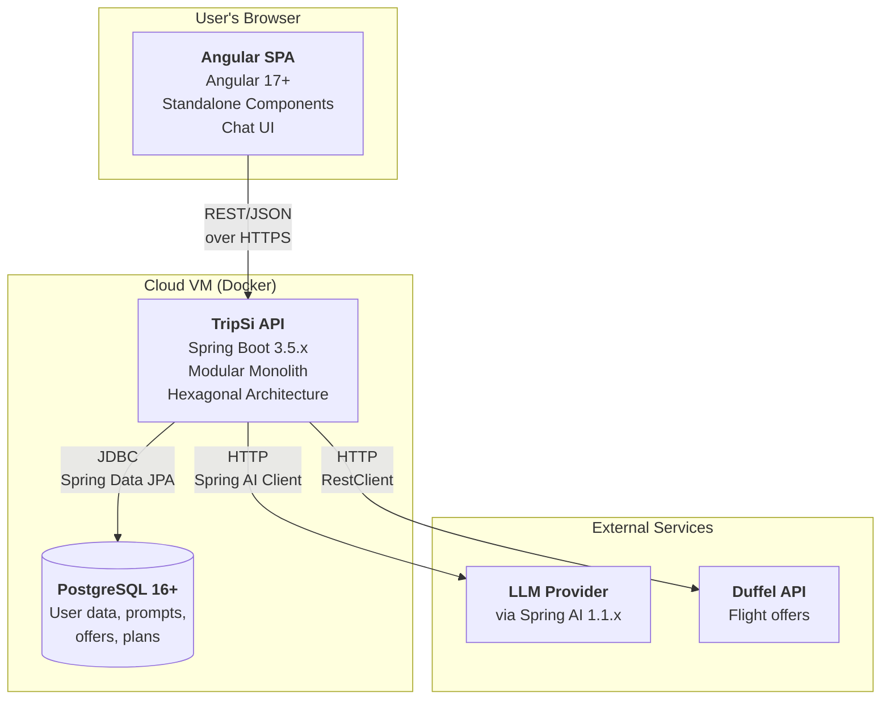

# TripSi - C4 Model

## Level 1: System Context



### Description

The traveller interacts with TripSi through a conversational chat interface built in Angular. The system processes natural language queries, communicates with an LLM provider (abstracted via Spring AI) for destination suggestions, offer analysis, and itinerary planning. Real flight data is retrieved from the Duffel API, with a mock fallback for demo reliability.

---

## Level 2: Container Diagram



### Containers

| Container        | Technology                                                | Purpose                                       |
| ---------------- | --------------------------------------------------------- | --------------------------------------------- |
| **Angular SPA**  | Angular 17+, Standalone Components, Signals               | Chat-based UI for trip planning flow          |
| **TripSi API**   | Spring Boot 3.5.x, Spring Modulith 2.1.x, Spring AI 1.1.x | Core business logic, hexagonal architecture   |
| **PostgreSQL**   | PostgreSQL 16+                                            | Persistent storage for all domain data        |
| **LLM Provider** | OpenAI / Anthropic / Google (TBD)                         | AI-powered suggestions, analysis, itineraries |
| **Duffel API**   | External REST API                                         | Real-time flight offers and airline data      |

---

## Level 3: Component Diagram (TripSi API)

```mermaid
graph TB
    subgraph "TripSi API - Spring Boot Modular Monolith"

        subgraph "shared (cross-cutting)"
            SEC["SecurityConfig<br/>JWT Filter"]
            EXH["GlobalExceptionHandler<br/><i>ProblemDetail RFC 9457</i>"]
            CID["CorrelationIdFilter<br/><i>MDC logging</i>"]
        end

        subgraph "user module"
            UC["UserController<br/>AuthController"]
            USP["UserServicePort<br/><i>primary port (interface)</i>"]
            US["UserService<br/><i>implements UserServicePort</i>"]
            UR["UserRepository<br/><i>JPA secondary port</i>"]
            UC -.->|depends on| USP
            US -.->|implements| USP
        end

        subgraph "suggestion module"
            SC["SuggestionController"]
            SSP["SuggestionServicePort<br/><i>primary port (interface)</i>"]
            SS["SuggestionService<br/><i>implements SuggestionServicePort</i>"]
            SR["PromptRepository<br/><i>JPA secondary port</i>"]
            SOR["SuggestionOptionRepository<br/><i>JPA secondary port</i>"]
            AIP["LlmSuggestionPort<br/><i>secondary port (interface)</i>"]
            AIA["SpringAiSuggestionAdapter<br/><i>implements LlmSuggestionPort</i>"]
            SC -.->|depends on| SSP
            SS -.->|implements| SSP
        end

        subgraph "flight module"
            FC["FlightController"]
            FEL["FlightOffersEventListener<br/><i>driving adapter</i>"]
            FSP["FlightServicePort<br/><i>primary port (interface)</i>"]
            FS["FlightService<br/><i>implements FlightServicePort</i>"]
            FR["FlightRequestRepository<br/><i>JPA secondary port</i>"]
            OR["OfferRepository<br/><i>JPA secondary port</i>"]
            DFP["FlightSearchPort<br/><i>secondary port (interface)</i>"]
            DFA["DuffelFlightAdapter<br/><i>@Profile prod</i>"]
            MFA["MockFlightAdapter<br/><i>@Profile dev</i>"]
            FC -.->|depends on| FSP
            FEL -.->|depends on| FSP
            FS -.->|implements| FSP
        end

        subgraph "recommendation module"
            RC["RecommendationController"]
            REL["RecommendationEventListener<br/><i>driving adapter</i>"]
            RSP["RecommendationServicePort<br/><i>primary port (interface)</i>"]
            RS["RecommendationService<br/><i>implements RecommendationServicePort</i>"]
            RR["RecommendationRepository<br/><i>JPA secondary port</i>"]
            RLP["LlmAnalysisPort<br/><i>secondary port (interface)</i>"]
            RLA["SpringAiAnalysisAdapter<br/><i>implements LlmAnalysisPort</i>"]
            RC -.->|depends on| RSP
            REL -.->|depends on| RSP
            RS -.->|implements| RSP
        end

        subgraph "planner module"
            PC["PlannerController"]
            PEL["PlannerEventListener<br/><i>driving adapter</i>"]
            PSP["PlannerServicePort<br/><i>primary port (interface)</i>"]
            PS["PlannerService<br/><i>implements PlannerServicePort</i>"]
            PR["PlannerRepository<br/><i>JPA secondary port</i>"]
            PLP["LlmPlannerPort<br/><i>secondary port (interface)</i>"]
            PLA["SpringAiPlannerAdapter<br/><i>implements LlmPlannerPort</i>"]
            PC -.->|depends on| PSP
            PEL -.->|depends on| PSP
            PS -.->|implements| PSP
        end
    end

    subgraph "External"
        DB[("PostgreSQL 16+")]
        LLM["LLM Provider"]
        DAPI["Duffel API"]
    end

    UR --> DB
    SR --> DB
    SOR --> DB
    FR --> DB
    OR --> DB
    RR --> DB
    PR --> DB

    AIA --> LLM
    RLA --> LLM
    PLA --> LLM
    DFA --> DAPI
```



### Hexagonal Architecture per Module

```
┌──────────────────────────────────────────────────────────────┐
│                        Module                                │
│                                                              │
│   ┌──────────┐    ┌───────────────┐    ┌───────────────┐    │
│   │Controller│    │ ServicePort   │    │   Service      │    │
│   │ (Driving │───>│ (Primary Port │<───│ (implements    │    │
│   │ Adapter) │    │  interface)   │    │  ServicePort)  │    │
│   └──────────┘    └───────────────┘    └───────┬───────┘    │
│   ┌──────────┐                                 │            │
│   │ Event    │───> (same primary port)         │            │
│   │ Listener │                         ┌───────┴────────┐   │
│   └──────────┘                         │ Secondary Port │   │
│                                        │  (interface)   │   │
│                                        └───────┬────────┘   │
│                                                │            │
│                          ┌─────────────┬───────┴──────┐     │
│                    ┌─────┴────┐  ┌─────┴─────┐  ┌─────┴──┐ │
│                    │JPA Repo  │  │API Adapter │  │Mock    │ │
│                    │(Postgres)│  │(Duffel/AI) │  │Adapter │ │
│                    └──────────┘  └───────────┘  └────────┘ │
└──────────────────────────────────────────────────────────────┘
```

### Module Boundaries (Spring Modulith)

| Module             | Owns Entities                     | References by UUID | Publishes Events          |
| ------------------ | --------------------------------- | ------------------ | ------------------------- |
| **user**           | User                              | —                  | —                         |
| **suggestion**     | Prompt, SuggestionOption          | userId (UUID)      | SuggestionCompletedEvent  |
| **flight**         | FlightRequest, Offer              | promptId (UUID)    | FlightOffersReceivedEvent |
| **recommendation** | Recommendation                    | promptId (UUID)    | RecommendationReadyEvent  |
| **planner**        | Planner, PlannerDay, PlannerBlock | promptId (UUID)    | PlannerCompletedEvent     |

### Inter-Module Communication (Spring Application Events)

```
User creates prompt
        │
        ▼
  ┌─────────────┐   SuggestionCompletedEvent   ┌──────────────┐
  │  suggestion  │─────────────────────────────>│    flight     │
  │   module     │                              │    module     │
  └─────────────┘                               └──────┬───────┘
                                                       │
                                          FlightOffersReceivedEvent
                                                       │
                                                       ▼
                                              ┌────────────────┐
                                              │ recommendation │
                                              │    module      │
                                              └───────┬────────┘
                                                      │
                                        RecommendationReadyEvent
                                                      │
                                                      ▼
                                              ┌───────────────┐
                                              │    planner     │
                                              │    module      │
                                              └───────────────┘
```

---

## Key Architectural Decisions

1. **Modular Monolith over Microservices** (ADR-001): Single deployable unit, module boundaries enforced by Spring Modulith at compile time. Reduces operational complexity for solo development.
2. **Hexagonal Architecture with Primary + Secondary Ports** (ADR-002): Each module exposes a primary port (ServicePort interface) that driving adapters (controllers, event listeners) depend on. Domain logic is isolated from infrastructure. External services (LLM, Duffel) are accessed through secondary port interfaces with concrete adapters.
3. **Spring AI Abstraction** (ADR-004): LLM provider is abstracted behind Spring AI, allowing provider switching (OpenAI, Anthropic, Google) without code changes in domain services.
4. **Event-Driven Module Communication** (ADR-005): Modules communicate through Spring Application Events, maintaining loose coupling. The suggestion module publishes SuggestionCompletedEvent; the flight module listens and triggers flight search.
5. **Mock Fallback Strategy** (ADR-010): Every external API adapter has a mock counterpart implementing the same port interface. Switched via Spring profiles (`@Profile("dev")` for mock, `@Profile("prod")` for real).
6. **Dependency Injection via Interfaces**: Controllers and event listeners inject the primary port interface (e.g., `UserServicePort`), never the concrete service class. Spring resolves the single `@Service` implementation automatically.
