# TripSi - Class Diagram

## Full Domain Model

```mermaid
classDiagram
    direction TB

    %% ============ USER MODULE ============
    namespace UserModule {
        class User {
            -UUID id
            -String name
            -String email
            -String password
            -Set~Role~ roles
            -Status status
            -Instant createdAt
            -Instant updatedAt
            -Instant deletedAt
            -Instant lastLoginAt
            -Instant emailVerifiedAt
            -long version
            +createNew(UserDTO) User
            +updateUser(UpdateUserDTO) void
            +softDelete() void
            +getRoles() Set~Role~
        }

        class UserPrincipal {
            <<adapter — adapter/in/security>>
            -User user
            +getAuthorities() Collection
            +getUsername() String
            +getPassword() String
            +isEnabled() boolean
        }

        class UserServicePort {
            <<interface>>
            +register(RegisterRequestDTO) UserResponseDTO
            +findById(UUID) UserResponseDTO
            +findByEmail(String) UserResponseDTO
            +update(UUID, UpdateUserDTO) UserResponseDTO
            +softDelete(UUID) void
        }

        class Role {
            <<enumeration>>
            ROLE_USER
            ROLE_ADMIN
        }

        class Status {
            <<enumeration>>
            ACTIVE
            SUSPENDED
            DELETED
        }
    }

    %% ============ SUGGESTION MODULE ============
    namespace SuggestionModule {
        class Prompt {
            -UUID id
            -UUID userId
            -String prompt
            -Location origin
            -RequestStatus status
            -Instant createdAt
            -Instant updatedAt
        }

        class SuggestionServicePort {
            <<interface>>
            +createPrompt(UUID, CreatePromptRequestDTO) PromptResponseDTO
            +findPromptById(UUID) PromptResponseDTO
            +findSuggestionsByPromptId(UUID) List~SuggestionOptionDTO~
        }

        class Location {
            <<embeddable>>
            -String name
            -String code
        }

        class SuggestionOption {
            -UUID id
            -String destination
            -String originAirportName
            -String originAirportCode
            -BigDecimal avgRoundtripEur
            -String reason
            -LocalDate suggestedDeparture
            -LocalDate suggestedReturn
            -Instant createdAt
        }

        class RequestStatus {
            <<enumeration>>
            PENDING
            SENT
            PROCESSED
            FAILED
        }
    }

    %% ============ FLIGHT MODULE ============
    namespace FlightModule {
        class FlightRequest {
            -UUID id
            -UUID promptId
            -CabinClass cabinClass
            -BigDecimal budget
            -String destination
            -String destinationFull
            -Integer maxConnections
            -RequestStatus status
            -Instant createdAt
            -Instant updatedAt
        }

        class FlightServicePort {
            <<interface>>
            +searchFlights(FlightSearchRequestDTO) void
            +findOffersByPromptId(UUID) List~OfferResponseDTO~
        }

        class SliceFlight {
            <<embeddable>>
            -String origin
            -String destination
            -LocalDate departureDate
        }

        class Passenger {
            <<embeddable>>
            -String type
            -Integer age
        }

        class Offer {
            -UUID id
            -UUID promptId
            -String externalOfferId
            -String owner
            -BigDecimal priceTotal
            -String priceCurrency
            -BookingConditions bookingConditions
            -Instant receivedAt
        }

        class FlightSegment {
            <<embeddable>>
            -Carrier marketingCarrier
            -Carrier operatingCarrier
            -String flightNumber
            -String origin
            -String destination
            -String departingAtIso
            -String arrivingAtIso
            -String durationIso
        }

        class Carrier {
            <<embeddable>>
            -String name
            -String iata
        }

        class BookingConditions {
            <<embeddable>>
            -BookingCondition refundBeforeDeparture
            -BookingCondition changeBeforeDeparture
        }

        class BookingCondition {
            <<embeddable>>
            -String penaltyCurrency
            -String penaltyAmount
            -boolean allowed
        }

        class CabinClass {
            <<enumeration>>
            ECONOMY
            PREMIUM_ECONOMY
            BUSINESS
            FIRST
        }
    }

    %% ============ RECOMMENDATION MODULE ============
    namespace RecommendationModule {
        class Recommendation {
            -UUID id
            -UUID promptId
            -String recommendExternalOfferId
            -String outboundSummary
            -String inboundSummary
            -BigDecimal priceAmount
            -String topPick
            -ScoreBreakdown scoreBreakdown
            -Instant createdAt
        }

        class RecommendationServicePort {
            <<interface>>
            +findByPromptId(UUID) RecommendationResponseDTO
        }

        class ScoreBreakdown {
            <<embeddable>>
            -String price
            -String time
            -String layovers
            -String timings
            -String otherConsiderations
        }

        class RecommendationAlternative {
            <<embeddable>>
            -String offerId
            -String why
        }
    }

    %% ============ PLANNER MODULE ============
    namespace PlannerModule {
        class Planner {
            -UUID id
            -UUID promptId
            -String destinationCity
            -String theme
            -BigDecimal dailyBudgetEur
            -String pace
            -DateRange dateRange
            -Instant createdAt
            -Instant updatedAt
        }

        class PlannerServicePort {
            <<interface>>
            +findByPromptId(UUID) PlannerResponseDTO
        }

        class DateRange {
            <<embeddable>>
            -LocalDate startDate
            -LocalDate endDate
        }

        class PlannerDay {
            -UUID id
            -LocalDate date
            -String summary
            -BigDecimal dailyEstimatedCostEur
            -String moneySaverTip
        }

        class PlannerBlock {
            -UUID id
            -LocalTime time
            -String title
            -String type
            -String url
            -String neighborhood
            -Integer durationMinutes
            -BigDecimal estimatedCostEur
            -boolean bookingNeeded
            -String notes
            -String mapsQuery
        }
    }

    %% ============ RELATIONSHIPS ============

    %% User module (internal)
    User --> Role : has many
    User --> Status : has one
    UserServicePort <|.. User : operates on
    UserPrincipal --> User : wraps (adapts to UserDetails)

    %% Suggestion module (internal JPA relationships)
    Prompt *-- Location : embeds
    Prompt --> RequestStatus : has one
    Prompt "1" --> "*" SuggestionOption : has many
    SuggestionServicePort <|.. Prompt : operates on

    %% Flight module (internal JPA relationships)
    Prompt "1" --> "*" FlightRequest : has many
    Prompt "1" --> "*" Offer : has many
    FlightRequest *-- SliceFlight : embeds many
    FlightRequest *-- Passenger : embeds many
    FlightRequest --> CabinClass : has one
    FlightRequest --> RequestStatus : has one
    Offer *-- BookingConditions : embeds
    Offer *-- FlightSegment : embeds many (outbound)
    Offer *-- FlightSegment : embeds many (inbound)
    FlightSegment *-- Carrier : embeds (marketing)
    FlightSegment *-- Carrier : embeds (operating)
    BookingConditions *-- BookingCondition : embeds (refund)
    BookingConditions *-- BookingCondition : embeds (change)

    %% Recommendation module (references by UUID)
    Recommendation *-- ScoreBreakdown : embeds
    Recommendation *-- RecommendationAlternative : embeds many

    %% Planner module (references by UUID)
    Planner *-- DateRange : embeds
    Planner "1" --> "*" PlannerDay : has many
    PlannerDay "1" --> "*" PlannerBlock : has many
```



---

## Module Ownership Summary

### user module
| Entity | Type | PK |
|--------|------|-----|
| User | Entity | UUID |

### suggestion module
| Entity | Type | PK / FK |
|--------|------|---------|
| Prompt | Entity (Aggregate Root) | UUID, FK: userId (UUID to User) |
| SuggestionOption | Entity | UUID, FK: promptId (JPA @ManyToOne) |
| Location | Embeddable | — |

### flight module
| Entity | Type | PK / FK |
|--------|------|---------|
| FlightRequest | Entity | UUID, FK: promptId (JPA @ManyToOne) |
| Offer | Entity | UUID, FK: promptId (JPA @ManyToOne) |
| SliceFlight | Embeddable | — |
| Passenger | Embeddable | — |
| FlightSegment | Embeddable | — |
| Carrier | Embeddable | — |
| BookingConditions | Embeddable | — |
| BookingCondition | Embeddable | — |

### recommendation module
| Entity | Type | PK / FK |
|--------|------|---------|
| Recommendation | Entity | UUID, FK: promptId (UUID value, no JPA relation) |
| ScoreBreakdown | Embeddable | — |
| RecommendationAlternative | Embeddable | — |

### planner module
| Entity | Type | PK / FK |
|--------|------|---------|
| Planner | Entity (Aggregate Root) | UUID, FK: promptId (UUID value, no JPA relation) |
| PlannerDay | Entity | UUID, FK: plannerId (JPA @ManyToOne) |
| PlannerBlock | Entity | UUID, FK: plannerDayId (JPA @ManyToOne) |
| DateRange | Embeddable | — |

---

## Changes from Original Model

| Change | Before | After | Reason |
|--------|--------|-------|--------|
| **FlightRequest cardinality** | @OneToOne with Prompt | @OneToMany with Prompt | Allows multiple flight searches per prompt |
| **UUID storage** | BINARY(16) (MySQL) | Native UUID (PostgreSQL) | PostgreSQL native type, no columnDefinition needed |
| **SuggestionStatus** | SuggestionStatus enum | RequestStatus enum | Clearer naming, used across modules |
| **Recommendation.prompt** | @ManyToOne JPA relation | UUID promptId (value) | Module boundary: recommendation module does not import Prompt class |
| **Planner.prompt** | @OneToOne JPA relation | UUID promptId (value) | Module boundary: planner module does not import Prompt class |
| **Prompt.userId** | @ManyToOne User JPA | UUID userId (value) + DB-level FK | Module boundary: suggestion module does not import User class. Integrity kept by `REFERENCES users(id)` in the Flyway migration; queried via `findByUserId...` |
| **FlightRequest/Offer** | FK via Prompt JPA | @ManyToOne Prompt (JPA) | Kept within suggestion/flight module boundary for query convenience |
| **Primary ports** | Not present | ServicePort interfaces added | Controllers/event listeners depend on interface, not concrete service (ADR-002) |

---

## Hexagonal Ports per Module

### user module
```
┌─ Primary Port (in) ──────────────────────┐
│  UserServicePort (interface)             │
│  - register(RegisterRequestDTO)          │
│  - findById(UUID)                        │
│  - findByEmail(String)                   │
│  - update(UUID, UpdateUserDTO)           │
│  - softDelete(UUID)                      │
│                                           │
│  Implemented by: UserService (@Service)  │
└───────────────────────────────────────────┘

┌─ Driving Adapters (depend on primary) ───┐
│  AuthController (REST)                   │
│  - POST /api/v1/auth/register            │
│  - POST /api/v1/auth/login               │
│  UserController (REST)                   │
│  - GET  /api/v1/users/me                 │
│  - PUT  /api/v1/users/me                 │
│  - DELETE /api/v1/users/me               │
│                                           │
│  UserDetailsServiceImpl (Spring Security)│
│  - loadUserByUsername(String)            │
│    → wraps User into UserPrincipal       │
│    (adapter/in/security/) — invoked BY   │
│    the Spring Security framework, same   │
│    role as a controller: external        │
│    stimulus calling into the module      │
└───────────────────────────────────────────┘

┌─ Secondary Ports (out) ──────────────────┐
│  UserRepository (JPA)                    │
│    extends JpaRepository<User, UUID>     │
└───────────────────────────────────────────┘
```

**Note**: `User` (domain) has no dependency on Spring Security — it exposes `getRoles(): Set<Role>` only. `UserPrincipal` (in `adapter/in/security/`) implements `UserDetails` and translates `Set<Role>` → `Collection<GrantedAuthority>`. This keeps the domain testable without the Spring Security classpath and keeps the auth strategy swappable without touching the domain (ADR-002).

### suggestion module
```
┌─ Primary Port (in) ──────────────────────┐
│  SuggestionServicePort (interface)       │
│  - createPrompt(UUID, CreatePromptDTO)   │
│  - findPromptById(UUID)                  │
│  - findSuggestionsByPromptId(UUID)       │
│                                           │
│  Implemented by: SuggestionService       │
└───────────────────────────────────────────┘

┌─ Driving Adapters (depend on primary) ───┐
│  SuggestionController (REST)             │
│  - POST /api/v1/prompts                  │
│  - GET  /api/v1/prompts/{id}             │
│  - GET  /api/v1/prompts/{id}/suggestions │
└───────────────────────────────────────────┘

┌─ Secondary Ports (out) ──────────────────┐
│  LlmSuggestionPort (interface)           │
│    └─ SpringAiSuggestionAdapter          │
│                                           │
│  PromptRepository (JPA)                  │
│  SuggestionOptionRepository (JPA)        │
└───────────────────────────────────────────┘
```

### flight module
```
┌─ Primary Port (in) ──────────────────────┐
│  FlightServicePort (interface)           │
│  - searchFlights(FlightSearchRequestDTO) │
│  - findOffersByPromptId(UUID)            │
│                                           │
│  Implemented by: FlightService           │
└───────────────────────────────────────────┘

┌─ Driving Adapters (depend on primary) ───┐
│  FlightController (REST)                 │
│  - POST /api/v1/flights/search           │
│  - GET  /api/v1/flights/offers/{promptId}│
│  FlightOffersEventListener               │
│  - listens: SuggestionCompletedEvent     │
└───────────────────────────────────────────┘

┌─ Secondary Ports (out) ──────────────────┐
│  FlightSearchPort (interface)            │
│    ├─ DuffelFlightAdapter (@Profile prod) │
│    └─ MockFlightAdapter (@Profile dev)   │
│                                           │
│  FlightRequestRepository (JPA)           │
│  OfferRepository (JPA)                   │
└───────────────────────────────────────────┘
```

### recommendation module
```
┌─ Primary Port (in) ──────────────────────┐
│  RecommendationServicePort (interface)   │
│  - findByPromptId(UUID)                  │
│                                           │
│  Implemented by: RecommendationService   │
└───────────────────────────────────────────┘

┌─ Driving Adapters (depend on primary) ───┐
│  RecommendationController (REST)         │
│  - GET /api/v1/recommendations/{promptId}│
│  RecommendationEventListener             │
│  - listens: FlightOffersReceivedEvent    │
└───────────────────────────────────────────┘

┌─ Secondary Ports (out) ──────────────────┐
│  LlmAnalysisPort (interface)             │
│    └─ SpringAiAnalysisAdapter            │
│                                           │
│  RecommendationRepository (JPA)          │
└───────────────────────────────────────────┘
```

### planner module
```
┌─ Primary Port (in) ──────────────────────┐
│  PlannerServicePort (interface)          │
│  - findByPromptId(UUID)                  │
│                                           │
│  Implemented by: PlannerService          │
└───────────────────────────────────────────┘

┌─ Driving Adapters (depend on primary) ───┐
│  PlannerController (REST)                │
│  - GET /api/v1/planner/{promptId}        │
│  PlannerEventListener                    │
│  - listens: RecommendationReadyEvent     │
└───────────────────────────────────────────┘

┌─ Secondary Ports (out) ──────────────────┐
│  LlmPlannerPort (interface)              │
│    └─ SpringAiPlannerAdapter             │
│                                           │
│  PlannerRepository (JPA)                 │
└───────────────────────────────────────────┘
```

---

## Dependency Injection Flow

```
┌────────────────────────────────────────────────────────────────────┐
│                    Spring IoC Container                            │
│                                                                    │
│  1. Component scan finds @Service UserService                     │
│  2. Registers it by concrete type AND by implemented interface    │
│  3. Controller declares: UserServicePort (interface)              │
│  4. Spring resolves: UserService (the only @Service impl)         │
│                                                                    │
│  ┌──────────────┐    inject     ┌──────────────────┐              │
│  │  Controller  │──────────────>│  ServicePort     │              │
│  │  (driving    │   by interface│  (primary port   │              │
│  │   adapter)   │               │   interface)     │              │
│  └──────────────┘               └────────┬─────────┘              │
│                                          │ implements             │
│  ┌──────────────┐               ┌────────┴─────────┐              │
│  │ EventListener│──────────────>│  Service         │              │
│  │  (driving    │   by interface│  (@Service impl) │              │
│  │   adapter)   │               └──────────────────┘              │
│  └──────────────┘                                                  │
│                                                                    │
│  For secondary ports with multiple adapters (e.g. FlightSearch): │
│  - @Profile("prod") → DuffelFlightAdapter                        │
│  - @Profile("dev")  → MockFlightAdapter                          │
│  Only ONE is active per profile → Spring resolves unambiguously   │
└────────────────────────────────────────────────────────────────────┘
```
